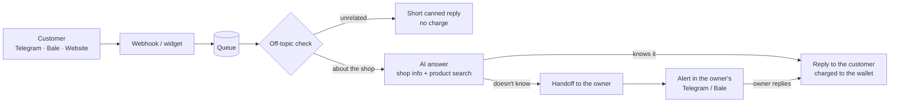

<div dir="rtl">

<h1 align="center">جواب</h1>

<p align="center">
<b>هیچ پیامی بی‌جواب نمی‌مونه.</b><br>
ادمین هوشمند فروشگاه‌های آنلاین: با اطلاعات و محصولات خود فروشگاه، شبانه‌روز و در چند ثانیه به مشتری‌ها جواب می‌دهد.
</p>

<p align="center">


</p>

---

## فهرست

- [«جواب» چیست](#about)
- [همه‌ی قابلیت‌ها](#features)
- [چطور کار می‌کند](#how)
- [اجرا روی کامپیوتر خودتان، قدم‌به‌قدم](#setup)
- [کار با ربات](#bot)
- [همه‌ی تنظیمات `.env`](#env)
- [نصب روی سرور](#deploy)
- [اسکریپت‌های کمکی](#scripts)
- [ساختار پروژه](#structure)
- [تست‌ها](#tests)
- [مستندات بیشتر](#docs)
- [وضعیت و قدم‌های بعدی](#status)

---

<a id="about"></a>

## «جواب» چیست

بیشتر پیام‌هایی که مشتری‌ها به یک فروشگاه آنلاین می‌دهند همان چند سؤال همیشگی‌اند: قیمت، موجودی، سایز، رنگ، هزینه‌ی ارسال، روش پرداخت. «جواب» با **اطلاعات و محصولات خود فروشگاه** به این پیام‌ها جواب می‌دهد، حتی ساعت دو بامداد.

چیزی از خودش نمی‌سازد. سؤالی را که جوابش در اطلاعات فروشگاه نیست حدس نمی‌زند؛ آن را به صاحب فروشگاه می‌سپارد و همان لحظه در تلگرام یا بله‌ی خودش خبرش می‌کند تا از همان‌جا جواب بدهد.

| کانال | وضعیت |
|---|---|
| ✈️ تلگرام | ✅ فعال: لینک اختصاصی فروشگاه، ربات اختصاصی، جواب از اکانت شخصی (Telegram Business)، کانال فروشگاه |
| 🟢 بله | ✅ فعال: لینک اختصاصی فروشگاه و ربات اختصاصی، بدون نیاز به فیلترشکن |
| 🌐 سایت | ✅ فعال: ویجت «از خود جواب بپرسید» برای دستیار خود «جواب» |
| 📷 اینستاگرام | ⏳ کدش آماده است و منتظر تأیید متا خاموش مانده |
| 💬 واتس‌اپ | ❌ فعلا نه: پلتفرم واتس‌اپ شماره‌های ایران را نمی‌پذیرد |

---

<a id="features"></a>

## همه‌ی قابلیت‌ها

### 🤖 جواب دادن هوشمند
- **فقط از اطلاعات خود فروشگاه:** ارسال، پرداخت، مرجوعی، سؤال‌های پرتکرار و لیست محصولات. قیمت، تخفیف یا موجودی از خودش نمی‌سازد.
- **جستجو در محصولات:** قبل از جواب دادن درباره‌ی یک محصول، قیمت، رنگ، سایز و موجودی را از لیست محصولات چک می‌کند. اگر رنگ یا سایزی تمام شده باشد، گزینه‌های موجود همان محصول را پیشنهاد می‌دهد.
- **فرستادن عکس محصول:** وقتی محصولی را پیشنهاد می‌دهد، پست کانال یا عکس همان محصول را هم می‌فرستد.
- **ارجاع به صاحب فروشگاه:** اگر جواب را نداند یا مشتری آدم بخواهد، بخشی را که می‌داند جواب می‌دهد و بقیه را با یک جمله‌ی طبیعی به صاحب فروشگاه می‌سپارد.
- **پیام‌های پشت‌سرهم:** برای «سلام» / «این مانتو» / «سایز ۴۴ داره؟» فقط **یک** جواب کامل می‌دهد.
- **لحن و قوانین:** صمیمی یا رسمی، با ایموجی یا بدون آن، و قوانینی که هیچ‌وقت زیرشان نمی‌زند (مثلا «هیچ‌وقت تخفیف نده»).
- **وقتی صاحب فروشگاه خودش جواب بدهد،** ربات برای آن مشتری کنار می‌کشد.
- **صفحه‌ی تست:** قبل از روشن کردن، جای مشتری سؤال بپرسید و جواب‌ها را ببینید، بدون اینکه پیامی برای کسی برود.

### 🛡 محافظت از اعتبار فروشگاه
- **سؤال‌های بی‌ربط** (آب‌وهوا، تکلیف، جوک) با یک بررسی کوچک و ارزان شناخته می‌شوند. مشتری یک جواب کوتاه «فقط درباره‌ی فروشگاه کمک می‌کنم» می‌گیرد، **بدون هزینه برای فروشگاه**. بعد از دو بار پشت سر هم، ربات ساکت می‌ماند تا سؤال خرید بپرسد.
- **سقف جواب برای هر مشتری** در ساعت (پیش‌فرض ۳۰)، تا یک اسپمر کیف پول را خالی نکند.
- **کیف پول خالی:** ربات هوش مصنوعی را صدا نمی‌زند و پیام‌ها را به صاحب فروشگاه می‌سپارد.

### 📦 معرفی محصولات به ربات، «هر جور راحت‌ترید»
- با **زبان خودتان بنویسید:** «مانتو کتان مشکی سایز ۴۴، یک و دویست، ۳ تا موجوده».
- **فایل** PDF، Word، Excel یا CSV، **عکس** لیست قیمت، یا **عکس محصول با توضیح** بفرستید.
- **لینک** گوگل شیت، گوگل داک یا فایل گوگل درایو بدهید. گوگل شیتی که ستون‌هایش مشخص باشد **زنده** وصل می‌شود و هر ۵ دقیقه به‌روز می‌شود.
- **پست‌های کانال تلگرام** را فوروارد کنید. اگر ربات را ادمین کانال کنید، پست‌های محصول جدید **خودکار** اضافه می‌شوند و دکمه‌ی «برگرداندن» دارند.
- **تغییرها** را هم همین‌طور بگویید: «مانتو کتان تموم شد» یا «قیمت شومیز حریر شد ۹۵۰».
- قبل از هر ثبت، **خلاصه‌ی چیزی که فهمیده** را نشان می‌دهد تا تأیید کنید. پیام‌های بعدی همان پیشنهاد را کامل یا اصلاح می‌کنند، مثلا «قیمتش رو بذار دو و پونصد».
- **کاتالوگ داخل خود «جواب»:** جستجو، فیلتر موجود/ناموجود، ویرایش دستی، و نمایش اینکه ربات دقیقا چه چیزی از هر محصول می‌داند.

### 📲 مدیریت از داخل تلگرام و بله
- **خبر فوری:** وقتی مشتری‌ای منتظر شماست، با دکمه‌های «✍️ جواب می‌دهم»، «✅ حل شد» و «⏸ ساکت شو».
- **جواب به مشتری از همان‌جا:** پیام بعدی‌تان مستقیم برای مشتری می‌رود.
- **منوی صاحب فروشگاه:** محصولات، کیف پول، خاموش و روشن کردن ربات، تست به‌عنوان مشتری، راهنما.
- **تأیید شماره‌ی موبایل** با یک دکمه (اشتراک‌گذاری شماره‌ی خود اکانت، رایگان و بدون پیامک).
- هشدار کم شدن و تمام شدن موجودی کیف پول، و خبر شارژ و تغییر پلن.

### 💳 کیف پول و پلن‌ها
- **پرداخت به اندازه‌ی مصرف:** هر جواب، به اندازه‌ی متنی که هوش مصنوعی می‌خواند و می‌نویسد، از کیف پول کم می‌شود. یک حداقل برای هر جواب هست و جواب معمولی حدود ۱۴۰ تومان است.
- **سه پلن:**

| پلن | چه می‌دهد | هزینه‌ی ماهانه |
|---|---|---|
| پایه | لینک اختصاصی فروشگاه روی ربات «جواب» در تلگرام و بله | ندارد |
| حرفه‌ای | + ربات اختصاصی با اسم و عکس فروشگاه | ۲۰۰ هزار تومان |
| بیزینس | + جواب از طرف اکانت شخصی تلگرام (Telegram Business) | ۴۰۰ هزار تومان |

- **شارژ با آبان گیت‌وی:** کارت‌به‌کارت با تأیید خودکار از روی پیامک بانک، بدون نیاز به اینماد. وبهوک امضاشده و بررسی دوره‌ای برای پرداخت‌هایی که خبرشان نرسیده. زرین‌پال هم به‌عنوان گزینه‌ی دوم هست.
- **هدیه‌ی شروع کار** (پیش‌فرض ۵۰ هزار تومان) فقط بعد از وصل کردن تلگرام یا بله و تأیید شماره، و برای هر نفر **فقط یک بار**، حتی با حذف و ساختن دوباره‌ی حساب.
- اعتبار شارژشده قابل استرداد نیست.

### 🔐 حساب کاربری و امنیت
- **تأیید ایمیل** با ایمیل HTML و دکمه، و **تأیید شماره** با پیامک (کاوه‌نگار یا SMS.ir) یا از داخل ربات.
- **فراموشی رمز** با لینک یک‌بارمصرف.
- **محدودیت ورود:** بعد از ۵ رمز اشتباه، ورود ۱۵ دقیقه بسته می‌شود.
- رمزها به صورت هش و توکن‌های ربات و اتصال‌ها رمزنگاری‌شده ذخیره می‌شوند. حذف حساب همه‌چیز را پاک می‌کند.
- صفحه‌های **حریم خصوصی**، **شرایط استفاده** و **حذف داده‌ها** به فارسی و انگلیسی.

### 🙋 «از خود جواب بپرسید»
فروشگاه خود «جواب» با همان ربات به سؤال‌های مردم درباره‌ی «جواب» جواب می‌دهد. یعنی **ما هم از محصول خودمان استفاده می‌کنیم**:
- در صفحه‌ی اول سایت، با دکمه‌ی شناور داخل پنل، و در ربات تلگرام و بله برای کسی که بدون لینک فروشگاه وارد شود.
- سؤالی که ربات نداند به تلگرام تیم می‌رسد و جواب تیم در همان پنجره‌ی گفتگو ظاهر می‌شود.
- قیمت‌ها و پلن‌ها زنده از تنظیمات سرور خوانده می‌شوند.
- **ضد اسپم:** سهمیه‌ی روزانه برای مهمان، کاربر واردشده، هر IP و کل مهمان‌ها، که با **یک حلقه** کنار گفتگو نشان داده می‌شود. مهمانی که سهمیه‌اش تمام شود به ساخت حساب رایگان دعوت می‌شود.

<a id="ops"></a>

### 🛠 پنل مدیریت تیم داخل ربات (`/ops`)
اعضای تیم در ربات تلگرام «جواب» دستور `/ops` را می‌فرستند و یک پنل کامل می‌گیرند که در یک پیام، با دکمه‌ها، جابه‌جا می‌شود:
- **🏠 خانه:**
  - فروشگاه‌ها (امروز و این هفته)، پیام‌رسان‌های وصل، هدیه‌ها
  - پیام‌ها و جواب‌های امروز، مشتری‌های منتظر
  - شارژ و مصرف امروز و ۳۰ روز، مجموع موجودی‌ها، پرداخت‌های معلق
- **🏪 فروشگاه‌ها:** سه فهرست تازه‌ترین، پرمصرف‌ترین و کم‌موجودی، و کارت کامل هر فروشگاه.
- **کارهای روی هر فروشگاه:** ➕ شارژ دستی، ➖ کسر، 📜 تراکنش‌ها، ✉️ پیام به صاحب فروشگاه، ⛔️ تعلیق یا رفع تعلیق. همه با تأیید قبلی و ثبت در دفتر کیف پول.
- **ابزارهای دیگر:** 🔍 جستجو، 💳 پرداخت‌ها، 📈 روند ۷ روز، 📣 پیام به همه‌ی صاحبان فروشگاه، ⚙️ وضعیت سیستم.
- ثبت‌نام‌های تازه و پرداخت‌ها هم خودکار به تیم خبر داده می‌شوند.

### 🧑‍💻 پنل وب فروشگاه
داشبورد و چک‌لیست راه‌اندازی، صندوق پیام همه‌ی کانال‌ها با امکان جواب دادن، ارجاع‌شده‌ها، سؤال‌های بی‌جواب (برای اضافه کردن جوابشان با یک کلیک)، اطلاعات فروشگاه، محصولات و «به جواب یاد بده»، تست ربات، تنظیمات لحن و قوانین، صفحه‌های تلگرام و بله، کیف پول و پلن، حساب کاربری، حالت تیره و دو زبان فارسی و انگلیسی.

### 🧯 پایش و پشتیبان‌گیری
- خطاها به Sentry و همان لحظه به یک گروه تلگرام تیم فرستاده می‌شوند.
- پشتیبان خودکار دیتابیس هر چند ساعت، با یک نسخه‌ی رمزشده در تلگرام تیم.

---

<a id="how"></a>

## چطور کار می‌کند

</div>



<div dir="rtl">

- **بک‌اند:** پایتون، FastAPI، SQLAlchemy (async)، PostgreSQL (روی کامپیوتر خودتان SQLite)، صف کارهای پس‌زمینه با arq و Redis.
- **پنل:** React 19، TypeScript، Vite، TanStack Query و Tailwind.
- **هوش مصنوعی:** هر سرویس سازگار با OpenAI که tool calling داشته باشد؛ الان AvalAI.
- **روی سرور:** Docker Compose و Caddy برای HTTPS خودکار.

---

<a id="setup"></a>

## اجرا روی کامپیوتر خودتان، قدم‌به‌قدم

### قدم ۰: پیش‌نیازها
- [uv](https://docs.astral.sh/uv/) برای پایتون
- [Node.js](https://nodejs.org/) نسخه‌ی ۲۰ یا بالاتر برای پنل
- اگر تلگرام فیلتر است، فیلترشکن روشن. بله فیلترشکن نمی‌خواهد.

به Docker و Redis روی کامپیوتر خودتان نیازی نیست.

### قدم ۱: نصب بک‌اند

</div>

```bash
cd backend
```

```bash
uv sync
```

<div dir="rtl">

<a id="step-env"></a>

### قدم ۲: ساخت فایل `backend/.env`
یک فایل به اسم `.env` داخل پوشه‌ی `backend` بسازید و این‌ها را در آن بگذارید (توضیح هر کدام در [جدول تنظیمات](#env) آمده):

</div>

```env
DATABASE_URL=sqlite+aiosqlite:///./dev.db
QUEUE_BACKEND=inline
SECRET_KEY=<a random string, 32+ characters>
ENCRYPTION_KEY=<output of the command below>

LLM_BASE_URL=https://api.avalai.ir/v1
LLM_API_KEY=<your AvalAI key>
LLM_MODEL=gpt-6-luna

TELEGRAM_BOT_TOKEN=<token from @BotFather>
BALE_BOT_TOKEN=<token from Bale's @botfather>
OPS_ADMIN_TELEGRAM_IDS=<your Telegram id>,<Ali's Telegram id>
```

<div dir="rtl">

مقدار `ENCRYPTION_KEY` را با این دستور بسازید:

</div>

```bash
uv run python -c "from cryptography.fernet import Fernet; print(Fernet.generate_key().decode())"
```

<div dir="rtl">

> **نکته:** اگر نمی‌خواهید موقع تست کیف پول خالی جلوی ربات را بگیرد، `BILLING_ENABLED=false` را هم اضافه کنید.
>
> روی ویندوز اگر متن فارسی در لاگ به شکل `س...` دیده شد، قبل از اجرای سرور `PYTHONUTF8=1` را در ترمینال تنظیم کنید.

### قدم ۳: ساخت دیتابیس و داده‌ی نمونه

</div>

```bash
uv run alembic upgrade head
```

```bash
uv run python -m scripts.seed_demo
```

<div dir="rtl">

دستور دوم یک فروشگاه نمونه‌ی پر به اسم «مزون مهسا» می‌سازد. ورود: `demo@shop.ir` با رمز `demopass123`.

### قدم ۴: روشن کردن بک‌اند (ترمینال ۱)

</div>

```bash
uv run uvicorn app.main:app --reload
```

<div dir="rtl">

مستندات تعاملی API در `http://localhost:8000/docs` باز می‌شود.

### قدم ۵: روشن کردن پنل (ترمینال ۲)

</div>

```bash
cd frontend
```

```bash
npm install
```

```bash
npm run dev
```

<div dir="rtl">

پنل را در `http://localhost:3000` باز کنید.

### قدم ۶: روشن کردن ربات‌های تلگرام و بله (ترمینال ۳)

</div>

```bash
cd backend
```

```bash
uv run python -m scripts.telegram_poll
```

<div dir="rtl">

این اسکریپت بدون نیاز به سرور عمومی، پیام‌های هر دو ربات را می‌گیرد و با همان کد سرور جواب می‌دهد. روی سرور واقعی به آن نیازی نیست و ربات‌ها با وبهوک کار می‌کنند.

### قدم ۷: امتحان کردن
1. در پنل به صفحه‌ی **تلگرام** یا **بله** بروید و **«ساخت لینک اتصال»** را بزنید. لینک را در گوشی باز کنید تا اکانت خودتان به‌عنوان صاحب فروشگاه وصل شود.
2. **لینک فروشگاه** را از همان صفحه کپی کنید و از یک اکانت دیگر باز کنید. حالا مشتری هستید؛ سؤال بپرسید.
3. سؤالی بپرسید که جوابش در اطلاعات فروشگاه نیست. خبرش با دکمه‌ی «✍️ جواب می‌دهم» به اکانت صاحب فروشگاه می‌آید.
4. در ربات، از اکانت صاحب فروشگاه، محصول تازه‌ای را بنویسید یا فایلی بفرستید. خلاصه را تأیید کنید و ببینید در صفحه‌ی محصولات پنل اضافه شده.
5. **پنل مدیریت تیم:** با اکانتی که شناسه‌اش در `OPS_ADMIN_TELEGRAM_IDS` است، دستور `/ops` را بفرستید.

### قدم ۸ (اختیاری): دستیار خود «جواب» روی سایت

</div>

```bash
uv run python -m scripts.seed_house --email team@example.com
```

<div dir="rtl">

فروشگاه خود «جواب» را با اطلاعات اولیه می‌سازد. اگر حسابی با آن ایمیل نباشد ساخته می‌شود و رمزش یک بار نمایش داده می‌شود. بعد بخش «از خود جواب بپرسید» در صفحه‌ی اول سایت کار می‌کند. با همان حساب وارد پنل شوید تا اطلاعاتش را کامل کنید و تلگرام تیم را وصل کنید.

---

<a id="bot"></a>

## کار با ربات

### برای مشتری
- لینک فروشگاه (`t.me/<ربات>?start=s_<کد>` یا `ble.ir/<ربات>?start=s_<کد>`) را باز می‌کند و سؤالش را می‌پرسد.
- اگر برنامه‌اش لینک را درست باز نکرد، **کد فروشگاه** را برای ربات می‌فرستد.
- کسی که بدون لینک وارد ربات «جواب» شود، با دستیار خود «جواب» حرف می‌زند.

### برای صاحب فروشگاه (بعد از وصل کردن اکانت)

| دستور یا دکمه | کار |
|---|---|
| `/admin` | منوی مدیریت فروشگاه |
| 📦 محصولات · `/products` | خلاصه‌ی محصولات ثبت‌شده |
| 💰 کیف پول · `/wallet` | موجودی و پلن |
| ⏸ خاموش کردن ربات · `/pause` / ▶️ روشن کردن ربات · `/resume` | خاموش و روشن کردن جواب‌دهی |
| 🧪 تست به‌عنوان مشتری · `/test` | دیدن ربات از چشم مشتری (`/admin` برای برگشتن) |
| 📱 تأیید شماره موبایل | تأیید شماره‌ی اکانت (برای هدیه) |
| ❓ راهنما · `/help` | راهنمای یاد دادن به ربات |
| `/cancel` | لغو کار در جریان (مثلا جواب دادن به مشتری) |
| هر متن، فایل، عکس، لینک یا پست فورواردشده | یاد دادن به ربات؛ خلاصه با دکمه‌های «✅ ثبت کن» و «❌ بی‌خیال» |

**ربات اختصاصی:** در BotFather ربات بسازید و توکنش را در صفحه‌ی تلگرام یا بله‌ی پنل بگذارید (پلن حرفه‌ای).

**جواب از اکانت شخصی (Telegram Business):** در تلگرام، Settings ← Telegram Business (در نسخه‌های جدید Chat Automation) ← Chatbots، و یوزرنیم ربات را اضافه کنید (پلن بیزینس). برای ربات مشترک باید در BotFather گزینه‌ی **Bot Settings ← Secretary Mode** (اسم قبلی‌اش Business Mode) روشن باشد.

**کانال تلگرام:** ربات را ادمین کانال کنید (فقط اجازه‌ی Post messages) تا پست‌های محصول جدید خودکار ثبت شوند.

### برای تیم «جواب»
`/ops` یا `/panel` در ربات تلگرام، فقط برای شناسه‌های `OPS_ADMIN_TELEGRAM_IDS`. جزئیاتش در [پنل مدیریت تیم](#ops).

---

<a id="env"></a>

## همه‌ی تنظیمات `.env`

- **روی کامپیوتر خودتان:** فایل `backend/.env`.
- **روی سرور:** فایل `.env` در **ریشه‌ی پروژه**، کنار `docker-compose.yml`. نمونه‌ی کاملش با توضیح هر خط در [`.env.example`](.env.example) است: `cp .env.example .env`.
- **پنل (اختیاری روی کامپیوتر خودتان):** فایل `frontend/.env` ([نمونه](frontend/.env.example)). روی سرور خودکار از `.env` ریشه ساخته می‌شود.

> ⚠️ فایل `.env` واقعی را **هرگز** در گیت نگذارید. کلیدها را در یک مدیر رمز نگه دارید.

### 🌐 پایه و دامنه‌ها

| متغیر | کاربرد | از کجا می‌آید | لازم؟ |
|---|---|---|---|
| `ENVIRONMENT` | `production` روی سرور؛ کلیدهای امن را اجباری می‌کند | خودتان | سرور |
| `API_DOMAIN` | دامنه‌ی API، مثلا `api.example.com` | دامنه‌ی خودتان (رکورد A به IP سرور) | سرور |
| `PANEL_DOMAIN` | دامنه‌ی پنل، مثلا `app.example.com` | دامنه‌ی خودتان (رکورد A به IP سرور) | سرور |
| `PUBLIC_BASE_URL` | آدرس کامل API؛ وبهوک‌های تلگرام، بله و درگاه روی آن تنظیم می‌شوند | `https://` + همان `API_DOMAIN` | سرور |
| `FRONTEND_URL` | آدرس پنل؛ لینک‌های ایمیل و پیام‌های ربات به آن اشاره می‌کنند | `https://` + همان `PANEL_DOMAIN` | سرور |
| `CORS_ORIGINS` | آدرس‌هایی که اجازه‌ی صدا زدن API را دارند | `["https://app.example.com"]` | سرور |
| `SUPPORT_EMAIL` | ایمیل پشتیبانی در صفحه‌های حقوقی | ایمیل تیم | سرور |
| `DATABASE_URL` | آدرس دیتابیس | روی کامپیوتر: `sqlite+aiosqlite:///./dev.db`؛ روی سرور خودکار | محلی |
| `POSTGRES_PASSWORD` | رمز دیتابیس روی سرور | یک رمز تصادفی بلند | سرور |
| `QUEUE_BACKEND` | `inline` روی کامپیوتر (بدون Redis)، `arq` روی سرور | خودتان | محلی |
| `REPLY_DEBOUNCE_SECONDS` | چند ثانیه صبر کند تا پیام‌های پشت‌سرهم مشتری یک جواب بگیرند (پیش‌فرض ۵) | خودتان | خیر |

### 🔑 کلیدهای امنیتی

| متغیر | کاربرد | از کجا می‌آید | لازم؟ |
|---|---|---|---|
| `SECRET_KEY` | امضای توکن‌های ورود و لینک‌های ایمیل | `python -c "import secrets; print(secrets.token_urlsafe(48))"` | ✅ |
| `ENCRYPTION_KEY` | رمزنگاری توکن ربات‌ها و اتصال‌ها در دیتابیس. **عوض کردن یا گم کردنش، توکن‌های ذخیره‌شده را غیرقابل خواندن می‌کند** | دستور Fernet در [قدم ۲](#step-env) | ✅ |

### 🧠 هوش مصنوعی

| متغیر | کاربرد | از کجا می‌آید | لازم؟ |
|---|---|---|---|
| `LLM_BASE_URL` | آدرس سرویس سازگار با OpenAI | AvalAI: `https://api.avalai.ir/v1` | ✅ |
| `LLM_API_KEY` | کلید سرویس | پنل AvalAI ← کلیدهای API (حساب باید اعتبار داشته باشد) | ✅ |
| `LLM_MODEL` | مدل اصلی؛ باید tool calling داشته باشد | مثلا `gpt-6-luna` | ✅ |
| `LLM_VISION_MODEL` | مدل خواندن عکس لیست قیمت؛ خالی یعنی همان مدل اصلی | فهرست مدل‌های AvalAI | خیر |
| `LLM_TRIAGE_MODEL` | مدل ارزان‌تر برای تشخیص سؤال بی‌ربط؛ خالی یعنی مدل اصلی | فهرست مدل‌های AvalAI | خیر |
| `LLM_MAX_OUTPUT_TOKENS` | حداکثر طول هر جواب (پیش‌فرض ۷۰۰) | خودتان | خیر |

بدون کلید هوش مصنوعی، ربات به جای جواب، پیام پیش‌فرض فروشگاه را می‌فرستد و گفتگو را به صاحب فروشگاه می‌سپارد.

### ✈️ تلگرام و بله

| متغیر | کاربرد | از کجا می‌آید | لازم؟ |
|---|---|---|---|
| `TELEGRAM_BOT_TOKEN` | ربات مشترک «جواب» در تلگرام | تلگرام ← BotFather ← `/newbot` | ✅ |
| `BALE_BOT_TOKEN` | ربات مشترک «جواب» در بله | اپ بله ← botfather ← `/newbot` | برای بله |
| `OPS_ADMIN_TELEGRAM_IDS` | شناسه‌ی عددی اعضای تیم (با کاما جدا) برای پنل `/ops` | به userinfobot در تلگرام پیام بدهید | توصیه‌شده |
| `OPS_TELEGRAM_CHAT_ID` | گروه تلگرام تیم برای هشدار خطا، پشتیبان‌ها و خبر ثبت‌نام و پرداخت | ربات را عضو گروه کنید و شناسه‌ی گروه را از userinfobot بگیرید | توصیه‌شده |

### 💳 کیف پول و قیمت‌ها (همه به **ریال**؛ هر تومان ۱۰ ریال)

| متغیر | کاربرد | پیش‌فرض |
|---|---|---|
| `BILLING_ENABLED` | `false` یعنی هیچ هزینه‌ای کم نمی‌شود | `true` |
| `SIGNUP_CREDIT_RIAL` | هدیه‌ی شروع کار؛ `0` یعنی بدون هدیه | ۵۰۰٬۰۰۰ (۵۰ هزار تومان) |
| `SIGNUP_GIFT_REQUIRES_PHONE` | هدیه فقط بعد از تأیید شماره | `true` |
| `USAGE_RIAL_PER_1K_PROMPT_TOKENS` / `USAGE_RIAL_PER_1K_COMPLETION_TOKENS` | قیمت هر هزار توکن ورودی و خروجی | ۳۰۰ / ۱٬۲۰۰ |
| `USAGE_MIN_RIAL_PER_REPLY` | حداقل هزینه‌ی هر جواب | ۵۰۰ |
| `LOW_BALANCE_RIAL` | زیر این موجودی به صاحب فروشگاه هشدار داده می‌شود | ۱۰۰٬۰۰۰ |
| `PLAN_PRO_MONTHLY_RIAL` / `PLAN_BUSINESS_MONTHLY_RIAL` | هزینه‌ی ماهانه‌ی پلن‌ها | ۲٬۰۰۰٬۰۰۰ / ۴٬۰۰۰٬۰۰۰ |
| `TOPUP_MIN_RIAL` / `TOPUP_MAX_RIAL` | کمترین و بیشترین مبلغ شارژ | ۵۰۰٬۰۰۰ / ۵۰۰٬۰۰۰٬۰۰۰ |
| `MAX_BOT_REPLIES_PER_CUSTOMER_HOUR` | سقف جواب به هر مشتری در ساعت | ۳۰ |
| `OFF_TOPIC_GUARD` / `OFF_TOPIC_MAX_REPLIES` | محافظ سؤال‌های بی‌ربط، و چند جواب کوتاه قبل از سکوت | `true` / ۲ |

### 🏦 درگاه پرداخت

| متغیر | کاربرد | از کجا می‌آید | لازم؟ |
|---|---|---|---|
| `PAYMENT_GATEWAY` | `aban` یا `zarinpal` | خودتان | ✅ |
| `ABAN_API_TOKEN` | توکن API آبان گیت‌وی؛ `ag_test_…` برای تست بدون پول، `ag_live_…` برای واقعی | پنل [آبان گیت‌وی](https://abangateway.ir) ← تنظیمات ← توکن‌های API | برای شارژ آنلاین |
| `ABAN_WEBHOOK_SECRET` | کلید امضای وبهوک آبان | پنل آبان ← تنظیمات ← وبهوک | برای شارژ آنلاین |
| `ABAN_INVOICE_MINUTES` | مهلت پرداخت هر فاکتور (پیش‌فرض ۳۰ دقیقه) | خودتان | خیر |
| `ZARINPAL_MERCHANT_ID` / `ZARINPAL_SANDBOX` | فقط اگر درگاه زرین‌پال باشد | پنل زرین‌پال | خیر |

در پنل آبان باید کارت را ثبت کنید و کیف پول کارمزد را شارژ کنید. آدرس وبهوک (`https://<API_DOMAIN>/api/v1/billing/aban/webhook`) با هر فاکتور خودکار فرستاده می‌شود. بدون درگاه، شارژ دستی از `/ops` یا با اسکریپت `wallet` انجام می‌شود.

### ✉️ ایمیل و 📱 پیامک

| متغیر | کاربرد | از کجا می‌آید | لازم؟ |
|---|---|---|---|
| `SMTP_HOST` / `SMTP_PORT` | سرور ارسال ایمیل (تأیید ایمیل، فراموشی رمز). بدون آن ایمیل‌ها فقط در لاگ API نوشته می‌شوند | Brevo: `smtp-relay.brevo.com` و `587`؛ Resend: `smtp.resend.com` و `587` | سرور |
| `SMTP_USERNAME` / `SMTP_PASSWORD` | ورود به سرویس ایمیل | Brevo: SMTP login و SMTP key؛ Resend: `resend` و API key | سرور |
| `SMTP_FROM` | فرستنده، مثلا `Javab <no-reply@example.com>`؛ دامنه‌اش باید در سرویس ایمیل تأیید شده باشد (رکوردهای SPF و DKIM) | دامنه‌ی خودتان | سرور |
| `SMTP_STARTTLS` / `SMTP_SSL` | برای پورت ۵۸۷: `true` / `false`؛ برای پورت ۴۶۵: `false` / `true` | خودتان | خیر |
| `SMS_PROVIDER` | `kavenegar` یا `smsir`؛ خالی یعنی کد فقط در لاگ نوشته می‌شود | خودتان | خیر |
| `SMS_API_KEY` | کلید سرویس پیامک | پنل کاوه‌نگار یا SMS.ir | با پیامک |
| `SMS_TEMPLATE` | قالب تأییدشده‌ی کد (کاوه‌نگار: اسم قالب با `%token`؛ SMS.ir: شناسه‌ی قالب با پارامتر `CODE`) | پنل سرویس پیامک | با پیامک |

بدون پیامک هم صاحب فروشگاه می‌تواند شماره‌اش را با دکمه‌ی «📱 تأیید شماره موبایل» در ربات تأیید کند.

### 🙋 دستیار سایت («از خود جواب بپرسید»)

| متغیر | کاربرد | پیش‌فرض |
|---|---|---|
| `SITE_ASSISTANT_SHOP_SLUG` | کد فروشگاه خود «جواب» که جواب می‌دهد | `javab` |
| `SITE_CHAT_GUEST_TOKENS` | سهمیه‌ی روزانه‌ی هر مهمان (هر جواب حدود ۳ تا ۵ هزار توکن) | ۲۵٬۰۰۰ |
| `SITE_CHAT_MEMBER_TOKENS` | سهمیه‌ی روزانه‌ی هر کاربر واردشده | ۱۰۰٬۰۰۰ |
| `SITE_CHAT_IP_TOKENS` | سهمیه‌ی روزانه‌ی همه‌ی مهمان‌های یک IP | ۱۵۰٬۰۰۰ |
| `SITE_CHAT_DAILY_TOKENS` | سقف روزانه‌ی کل مهمان‌ها | ۳٬۰۰۰٬۰۰۰ |

### 🔒 امنیت، پایش و پشتیبان

| متغیر | کاربرد | از کجا می‌آید | لازم؟ |
|---|---|---|---|
| `LOGIN_MAX_FAILURES` / `LOGIN_FAILURE_WINDOW_MINUTES` | چند رمز اشتباه در چند دقیقه تا بسته شدن موقت ورود | خودتان (پیش‌فرض ۵ و ۱۵) | خیر |
| `SENTRY_DSN` | گزارش خطاها | پروژه‌ای در [Sentry](https://sentry.io) یا GlitchTip | توصیه‌شده |
| `BACKUP_PASSPHRASE` | رمز نسخه‌ی رمزشده‌ی پشتیبان که به گروه تیم فرستاده می‌شود؛ **بدون آن پشتیبان‌ها باز نمی‌شوند** | یک رمز بلند در مدیر رمز | توصیه‌شده |
| `BACKUP_INTERVAL_HOURS` / `BACKUP_KEEP_DAYS` | هر چند ساعت پشتیبان، و چند روز نگهداری | خودتان (پیش‌فرض ۶ و ۱۴) | خیر |

### 📷 اینستاگرام (فعلا خاموش)

| متغیر | کاربرد | از کجا می‌آید |
|---|---|---|
| `INSTAGRAM_ENABLED` | تا تأیید متا `false` | خودتان |
| `META_APP_ID` / `META_APP_SECRET` | شناسه و کلید اپ **اینستاگرام** (نه فیسبوک) | Meta App Dashboard ← Instagram ← API setup with Instagram login |
| `META_WEBHOOK_VERIFY_TOKEN` | هر رشته‌ی تصادفی؛ همان را در تنظیمات وبهوک متا بزنید | خودتان |
| `INSTAGRAM_DRY_RUN` | روی کامپیوتر خودتان: جواب‌ها به جای ارسال، در لاگ چاپ می‌شوند | خودتان |

### 🖥 پنل (`frontend/.env`)

| متغیر | کاربرد | پیش‌فرض |
|---|---|---|
| `VITE_API_URL` | آدرس بک‌اند | `http://localhost:8000` |
| `VITE_SUPPORT_EMAIL` | ایمیل پشتیبانی در صفحه‌های حقوقی | `support@javab.app` |

---

<a id="deploy"></a>

## نصب روی سرور

یک سرور لینوکس با Docker، مثلا یک VPS در اروپا، و دو زیردامنه که رکورد A آن‌ها به IP سرور اشاره کند (برای API و پنل).

</div>

```bash
git clone https://github.com/mehrshot/InstagramDMBot.git
```

```bash
cd InstagramDMBot
```

```bash
cp .env.example .env
```

<div dir="rtl">

فایل `.env` را طبق [جدول بالا](#env) پر کنید، بعد:

</div>

```bash
docker compose up -d --build
```

<div dir="rtl">

این دستور همه‌چیز را بالا می‌آورد:

| سرویس | کار |
|---|---|
| `db` | دیتابیس PostgreSQL |
| `redis` | صف کارهای پس‌زمینه |
| `api` | بک‌اند؛ migrationها خودکار اجرا و وبهوک ربات‌های تلگرام و بله خودکار تنظیم می‌شوند |
| `worker` | جواب دادن به مشتری‌ها، همگام‌سازی گوگل شیت، تمدید پلن‌ها، بررسی پرداخت‌ها |
| `web` | پنل، و HTTPS خودکار هر دو دامنه با Caddy |
| `backup` | پشتیبان خودکار دیتابیس در `./backups` ([بازگردانی](deploy/backup/RESTORE.md)) |

بعد از نصب:

</div>

```bash
docker compose exec api python -m scripts.seed_house --email team@example.com
```

```bash
docker compose exec api python -m scripts.send_test_email you@example.com
```

<div dir="rtl">

به‌روزرسانی بعد از هر تغییر:

</div>

```bash
git pull && docker compose up -d --build
```

<div dir="rtl">

---

<a id="scripts"></a>

## اسکریپت‌های کمکی

همه داخل پوشه‌ی `backend` اجرا می‌شوند: روی کامپیوتر خودتان با `uv run python -m scripts.<اسم>` و روی سرور با `docker compose exec api python -m scripts.<اسم>`.

| اسکریپت | کار |
|---|---|
| `seed_demo` | فروشگاه نمونه‌ی «مزون مهسا» با محصولات و اطلاعات (`demo@shop.ir` / `demopass123`) |
| `seed_house --email <ایمیل>` | ساخت یا به‌روز کردن فروشگاه خود «جواب» برای دستیار سایت (`--reset-knowledge` اطلاعات را از نو می‌نویسد) |
| `telegram_poll` | اجرای ربات‌های تلگرام و بله روی کامپیوتر خودتان، بدون سرور عمومی |
| `wallet show/credit/debit <ایمیل> [تومان] ["توضیح"]` | دیدن موجودی و تراکنش‌ها، شارژ دستی یا کسر از کیف پول |
| `send_test_email <ایمیل>` | تست تنظیمات ایمیل |
| `check_llm` | تست هوش مصنوعی واقعی با سه سناریو و تخمین هزینه‌ی هر جواب |
| `simulate` | شبیه‌سازی دایرکت اینستاگرام بدون متا (با `INSTAGRAM_ENABLED=true`) |
| `export_openapi` | خروجی گرفتن از قرارداد API در `docs/openapi.json` |

---

<a id="structure"></a>

## ساختار پروژه

</div>

```text
backend/
  app/
    api/routes/   endpointها: حساب، کیف پول، تلگرام و بله، محصولات، یاد دادن، سایت، وبهوک‌ها
    core/         تنظیمات، دیتابیس، امنیت، محدودیت درخواست، پایش
    models/       جدول‌های دیتابیس
    services/     منطق اصلی:
                    responder      جواب هوش مصنوعی و محافظ سؤال بی‌ربط
                    messaging      مسیر پیام: ثبت، جواب، ارجاع، هزینه
                    channels       ارسال در هر کانال (تلگرام، بله، سایت، اینستاگرام)
                    telegram_bot   ربات: مشتری، صاحب فروشگاه، کانال، Business
                    ops_bot        پنل مدیریت تیم (/ops)
                    teach          یاد دادن از متن، فایل، عکس، لینک و پست
                    billing, payments, gifts   کیف پول، درگاه، هدیه
                    site_chat      دستیار سایت و سهمیه‌ها
    worker.py     کارهای پس‌زمینه و زمان‌بندی‌شده (arq)
  alembic/        migrationهای دیتابیس
  scripts/        اسکریپت‌های کمکی
  tests/          ۱۸۴ تست
frontend/         پنل و سایت (React + TypeScript + Vite)
deploy/           Caddy، ساخت پنل، پشتیبان‌گیری
docs/             راهنمای فرانت، قرارداد API، راهنماهای راه‌اندازی
docker-compose.yml
.env.example      همه‌ی تنظیمات سرور با توضیح
```

<div dir="rtl">

---

<a id="tests"></a>

## تست‌ها

</div>

```bash
cd backend
```

```bash
uv run pytest
```

<div dir="rtl">

تست‌ها هیچ سرویس بیرونی را صدا نمی‌زنند؛ تلگرام، بله، هوش مصنوعی، درگاه‌ها و گوگل همه شبیه‌سازی می‌شوند. برای پنل:

</div>

```bash
cd frontend
```

```bash
npm run build
```

<div dir="rtl">

---

<a id="docs"></a>

## مستندات بیشتر

| سند | محتوا |
|---|---|
| [docs/FRONTEND.md](docs/FRONTEND.md) | قرارداد کامل API و راهنمای پنل (برای فرانت‌اند) |
| [docs/openapi.json](docs/openapi.json) | اسکیمای API؛ تایپ‌های پنل با `npm run gen:api` از آن ساخته می‌شوند |
| [frontend/README.md](frontend/README.md) | اجرای پنل و ساختار آن |
| [docs/channels-plan.md](docs/channels-plan.md) | بررسی کانال‌ها: تلگرام، بله، واتس‌اپ، اینستاگرام |
| [docs/setup-guide.html](docs/setup-guide.html) | راهنمای اجرایی راه‌اندازی (دامنه، سرور، اولین تست واقعی) |
| [docs/launch-guide.html](docs/launch-guide.html) | نقشه‌ی لانچ و کارهای بیرون از کد |
| [deploy/backup/RESTORE.md](deploy/backup/RESTORE.md) | بازگردانی پشتیبان دیتابیس |

مستندات تعاملی API روی هر سرور در `/docs` در دسترس است.

---

<a id="status"></a>

## وضعیت و قدم‌های بعدی

- ✅ تلگرام و بله، کیف پول، آبان گیت‌وی، پنل مدیریت تیم، دستیار سایت، تأیید ایمیل و شماره: آماده‌ی لانچ.
- ⏳ **اینستاگرام:** کدش کامل است و منتظر تأیید متا؛ بعد از تأیید فقط `INSTAGRAM_ENABLED=true`.
- 🔜 **پیام صوتی:** فهمیدن پیام صوتی صاحب فروشگاه، به‌عنوان یک قابلیت جدا.

</div>
